# AVA Pitch Side

Fast top-down football in C# on .NET 10 and Avalonia 12, eleven a side. Tap to pass and hold to shoot, then bend
the ball in flight with the stick. Slide in for the ball, head the crosses, and beat a keeper who dives. Play
through a three-round cup against the computer, or a friend at the same keyboard.

## Features

- **Eleven a side** on a full-size pitch (68 m by 105 m) that scrolls with the ball, with a radar of the whole
  pitch in the corner. Each side plays a flat four-four-two. Eleven, not seven, because the positional game is
  the point: the computer's shape and runs need the full width to make passes worth choosing.
- **One button**:
  - With the ball, a tap passes to the best team-mate the way you face, and holding shoots harder and higher the
    longer you hold.
  - Without the ball, a tap slides in, heads a ball in the air, or volleys one at your feet.
- **Aftertouch**: for a moment after a kick the stick bends the ball. Sideways curls it, back lifts it, forward
  keeps it down.
- **Ball physics**: height, gravity and bounce, rolling friction, spin, the posts and the crossbar, and the net.
- **The laws, more or less**:
  - Throw-ins, corners, goal kicks and kickoffs after goals.
  - Fouls: a slide that hits the man before the ball gives a free kick, or a penalty in the area.
  - Keepers may not handle a pass from their own side.
  - There's no offside, as in most games of this kind, so forwards can hang about.
- **Keepers** narrow the angle, come for loose balls in the area, dive at shots on target, catch what they can
  hold and parry the rest, wide or round the post.
- **The computer's football**:
  - Formation places that shift with the ball, pushing up when the side has it and dropping goal-side when it
    hasn't.
  - The nearest one or two press. The man on the ball dribbles round opponents, passes to open team-mates,
    crosses from the wing, clears under pressure and shoots.
  - Its skill sets the reactions, the accuracy and how often it wins the ball.
- **One-player cup**: quarter-final, semi-final and final against the computer, which grows harder with each
  round from a level of easy, normal or hard. A drawn tie goes to a **penalty shoot-out**. Points are scored for
  goals, wins, the margin and winning the cup.
- **Two players**: a friendly at one keyboard, or on two gamepads.
- **Eight made-up clubs** with their own home and away strips (worn when the colours would clash), squads of
  invented players, and a strength each.
- **Replays** of every goal at half speed, the scorer's celebration, the crowd and the advertising boards.
- **Half-time and full-time cards**, a top-ten high-score table with arcade-style initials entry, and **a
  demonstration** match after the title has been left alone.
- **Keyboard or gamepads**, **any window size** (the 4:3 screen scales to fit), and **Ctrl+S** for a screenshot.
- **Synthesised sound**: kicks, headers, tackles, the woodwork, the whistle, a crowd that hums, groans and roars,
  and a terrace anthem on the title.

## Screenshots

| Title | Team select | Kick-off |
|:-----:|:-----------:|:--------:|
| 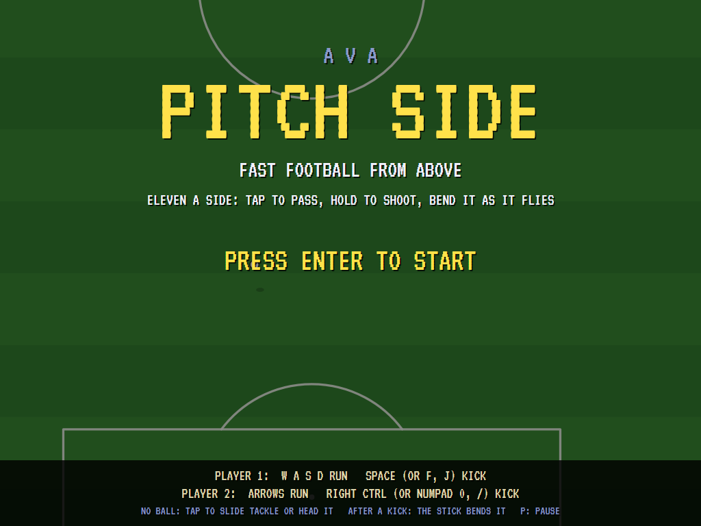 | 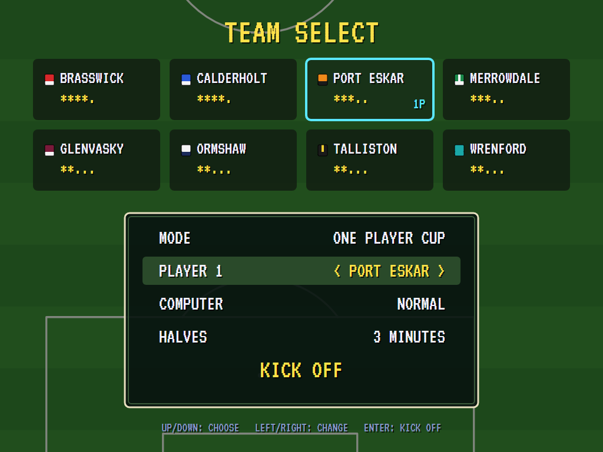 | 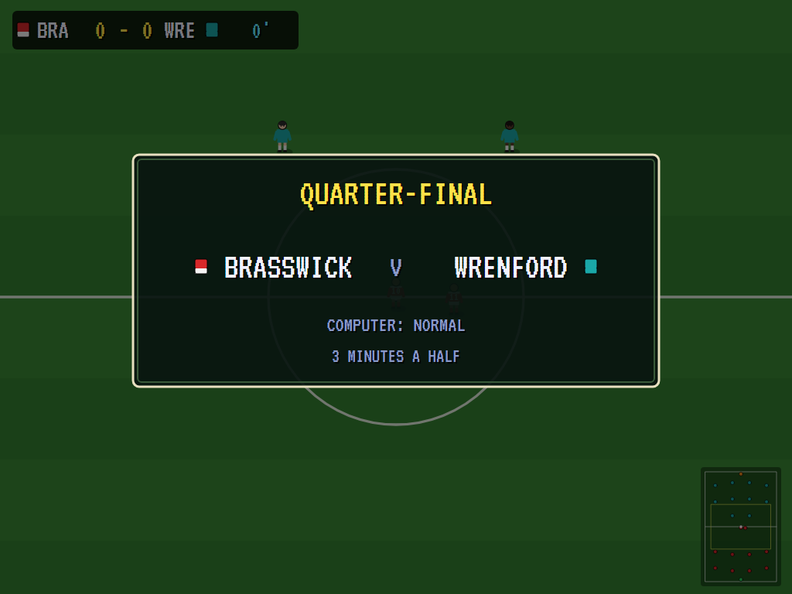 |
| The pitch drifting under the title. | Eight clubs, the mode, the level, the halves. | The cup's first round. |

| Open play | A shot | Goal! |
|:---------:|:------:|:-----:|
| 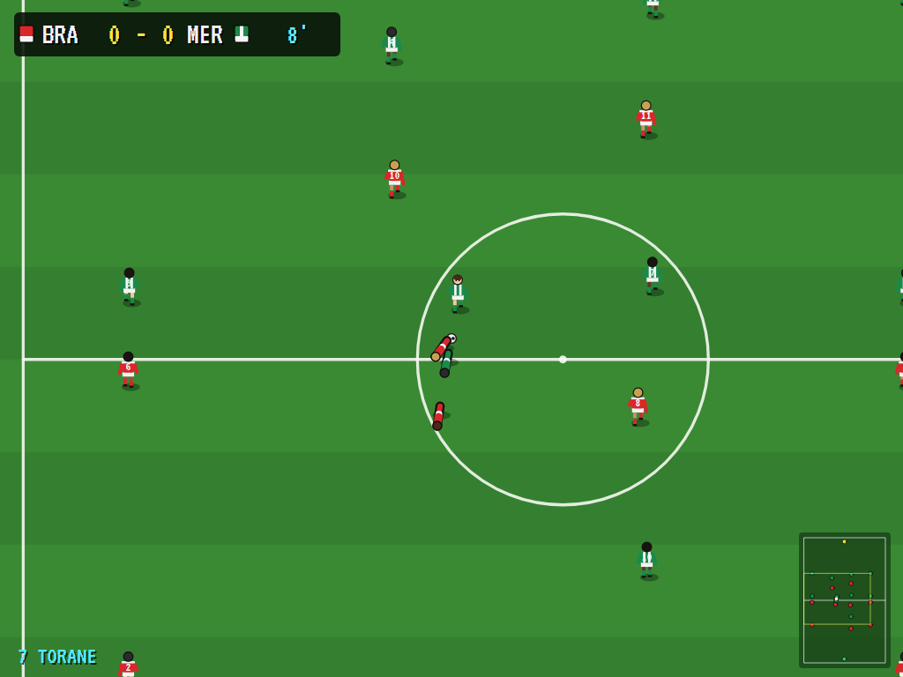 | 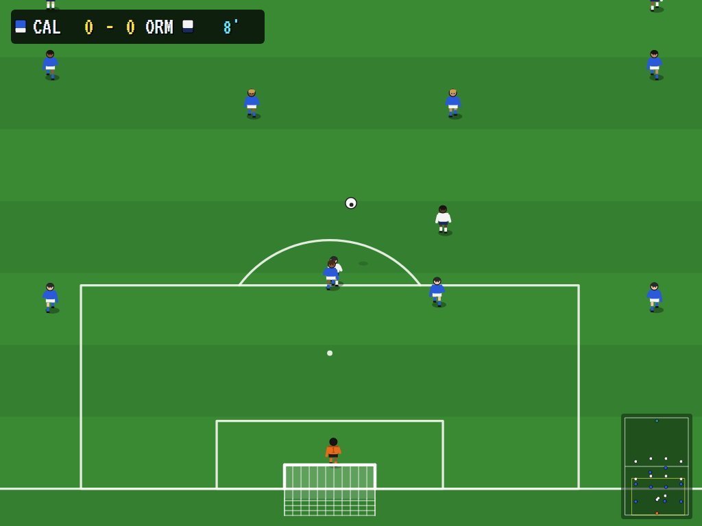 | 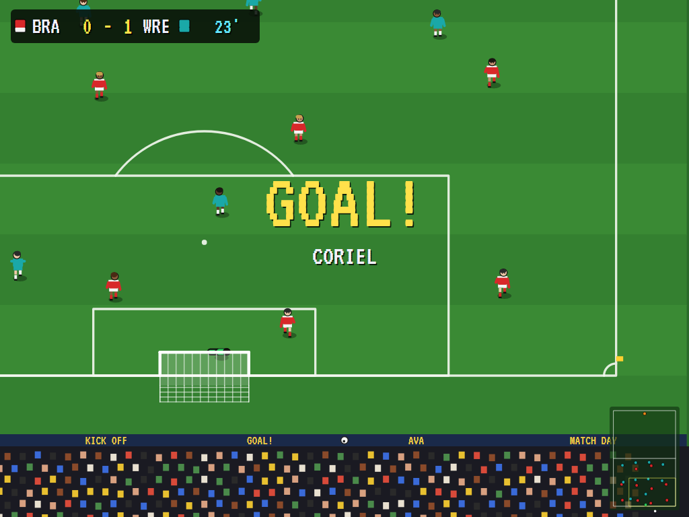 |
| In midfield. | A ball in the air, its shadow on the grass. | The ball in the net. |

| The replay | A corner | Penalties |
|:----------:|:--------:|:---------:|
| 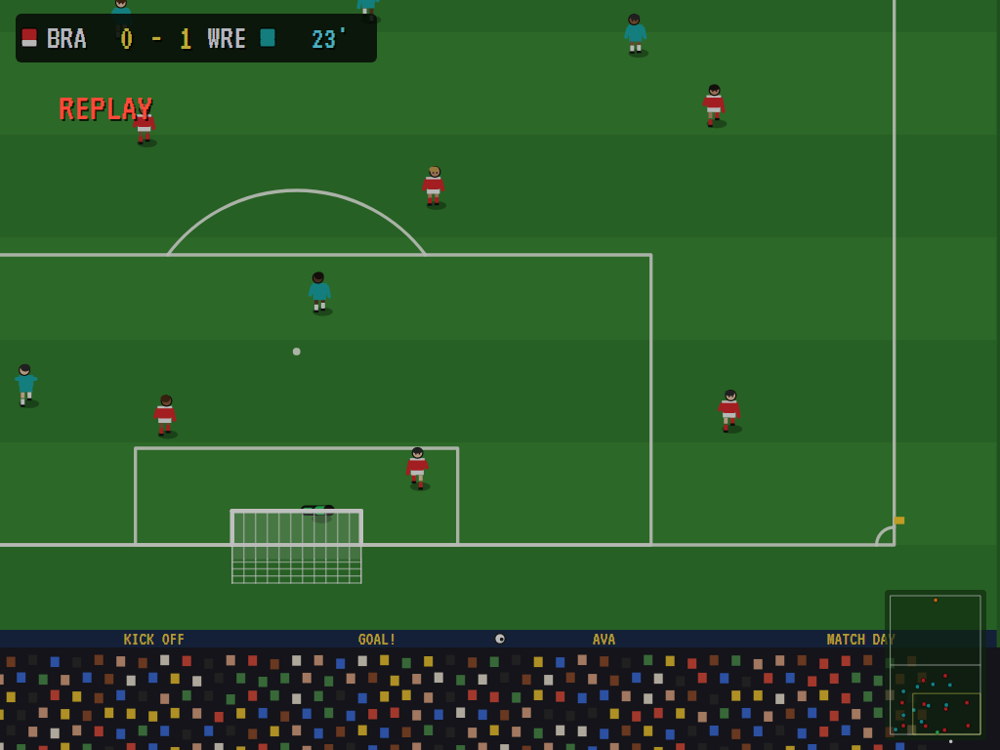 | 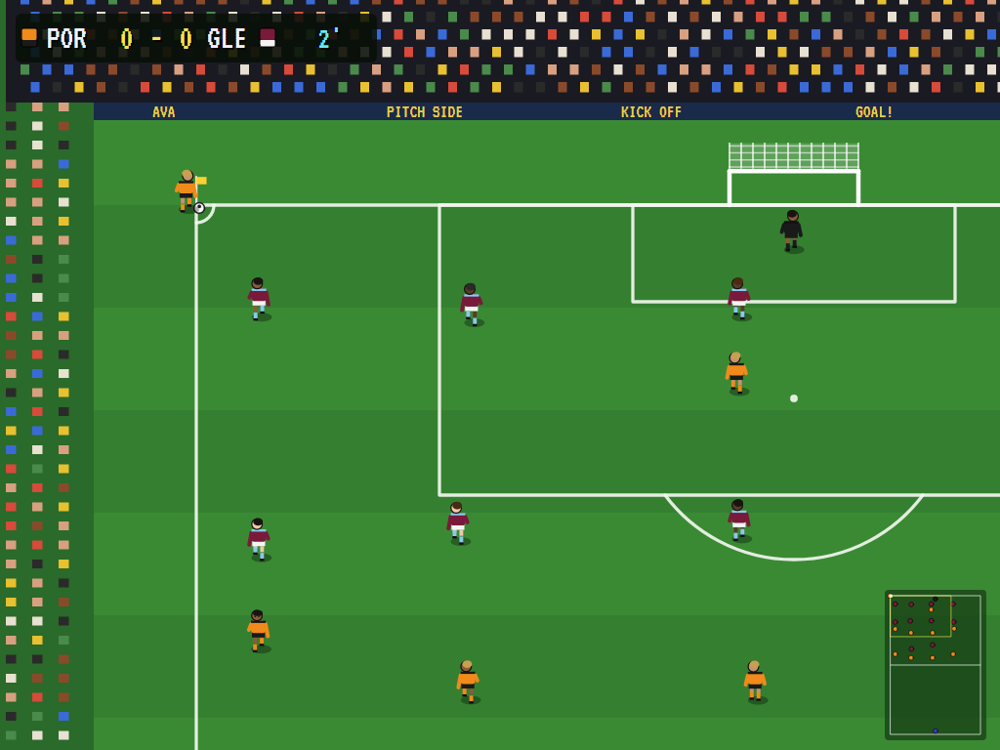 | 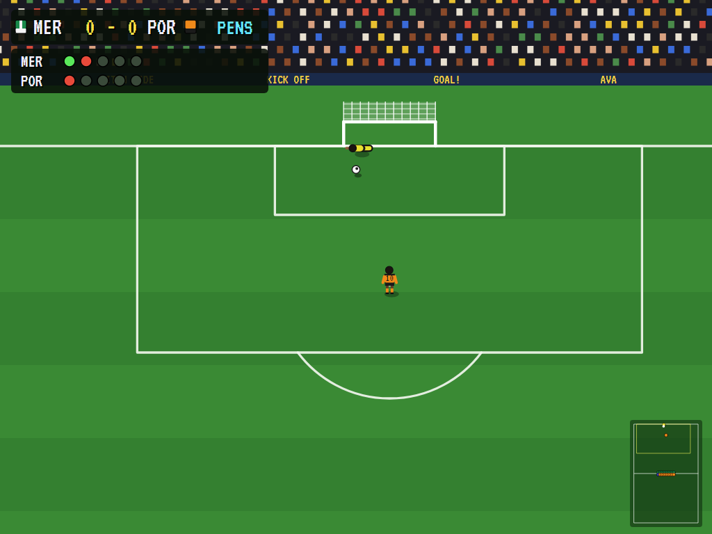 |
| The goal again, at half speed. | From the flag. | The shoot-out after a draw. |

| Half time | Out of the cup | High scores |
|:---------:|:--------------:|:-----------:|
| 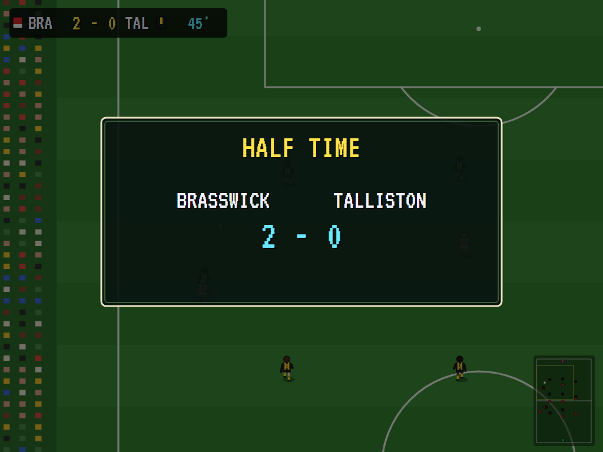 | 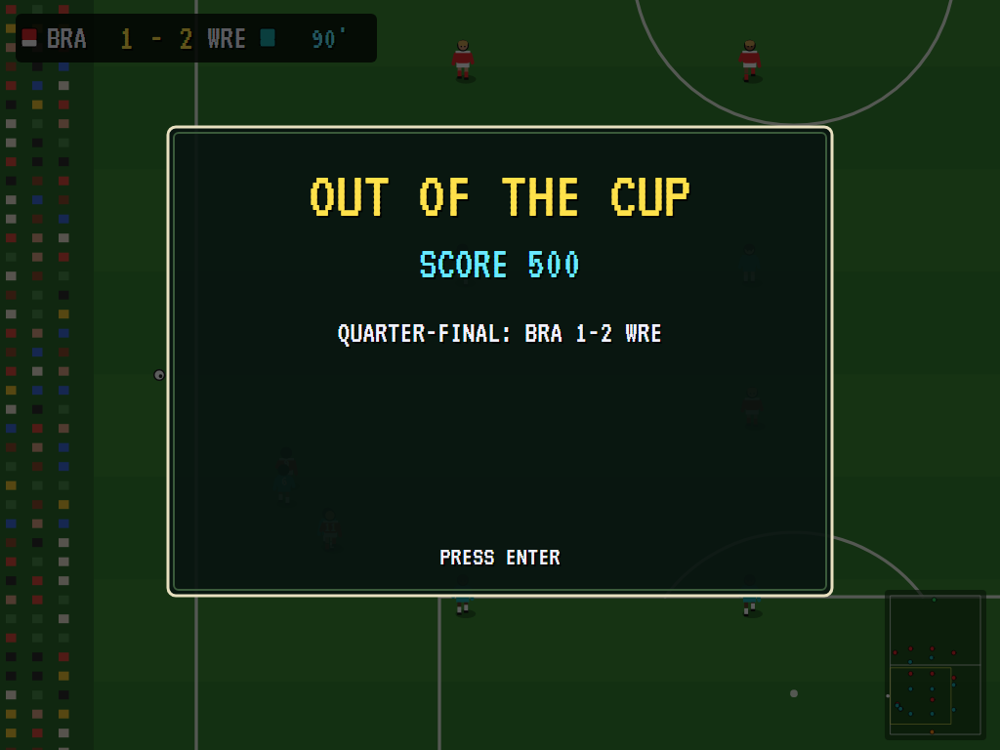 | 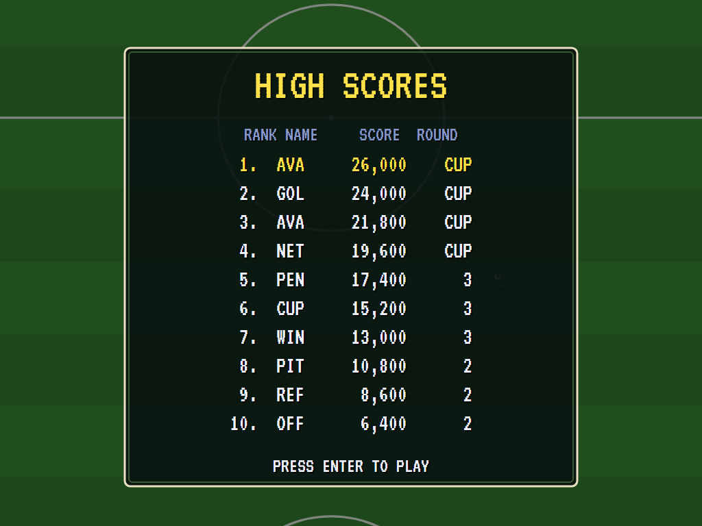 |
| The score at the break. | The cup run, round by round. | The top ten. |

## Download and run

Ready-to-run builds for Windows, macOS and Linux, on both Intel/AMD and ARM, are on the
[Releases page](https://github.com/Harlock123/AVAPitchSide/releases/tag/latest). **Latest build** is
rebuilt on every push to `main`. Each download is one self-contained executable: no .NET install is
needed.

| Platform | Archive |
|---|---|
| Windows | `AVAPitchSide-win-x64.zip`, `AVAPitchSide-win-x86.zip`, `AVAPitchSide-win-arm64.zip` |
| macOS | `AVAPitchSide-osx-arm64.tar.gz` (Apple silicon), `AVAPitchSide-osx-x64.tar.gz` (Intel) |
| Linux | `AVAPitchSide-linux-x64.tar.gz`, `AVAPitchSide-linux-arm64.tar.gz`, `AVAPitchSide-linux-arm.tar.gz` |

```bash
tar -xzf AVAPitchSide-linux-x64.tar.gz     # or linux-arm64, linux-arm, osx-arm64, osx-x64
./AVAPitchSide
```

On Windows, unzip and run `AVAPitchSide.exe`. On macOS, if Gatekeeper refuses to open it, run
`xattr -d com.apple.quarantine AVAPitchSide` once. Run with `--no-audio` for silence.

**Sound** comes through OpenAL Soft, built in for every platform. In a virtual machine the game
detects it and uses a larger audio buffer, so the sound doesn't break up.

**Gamepads** use SDL2, which is bundled for Windows, macOS and Intel/AMD Linux. ARM Linux builds need it
installed; without it the keyboard still works:

```bash
sudo apt install libsdl2-dev            # Debian / Ubuntu / Raspberry Pi OS
sudo pacman -S --needed sdl2-compat     # Arch / Omarchy
```

## Controls

| Action | Player 1 keys | Player 2 keys | Gamepad |
|---|---|---|---|
| Run | W A S D | Arrows | Stick or D-pad |
| Pass (tap) or shoot (hold), with the ball | Space, F or J | Right Ctrl, NumPad 0 or / | A, B or X |
| Slide tackle, header or volley, without it | the same | the same | the same |
| Bend the ball just kicked | the stick, at once | | |
| Start | Enter or 1 | | Start |
| Pause | P or Esc | | Start |
| Sound on/off | M | | |
| Screenshot | Ctrl+S (to your Pictures folder) | | |

You play the outfield player nearest the ball, marked with an arrow, or whoever has it. The keeper is always the
computer's. In a one-player game both sets of keys and both gamepads control your side. Throw-ins, corners, free
kicks and penalties are yours to take: the stick aims, a tap passes, and holding shoots (or throws long). On the
select screen, up and down choose a line and left and right change it; Enter kicks off. On the high-score table,
type your initials, or use up/down and Space, then Enter.

## Tests

`dotnet test` runs them all headless. The gameplay tests check the following:

- Through the real key handler: that up runs up the screen with the ball at the feet, that a tap passes to a
  team-mate, that holding shoots and the goal counts (with the other side kicking off), and that aftertouch bends
  the shot either way.
- That a rolling ball stops where its friction says, and that a ball in the air rises as high as gravity allows
  and bounces.
- That a keeper holds a shot at him, and can't handle a back pass.
- That the touchline gives a throw-in to the other side, and the goal line a goal kick or a corner.
- That a slide at the ball is fair and one through the man is a foul, giving a free kick or a penalty, and that a
  standing tackle wins the ball in time.
- That the computer plays a whole match with shots and restarts, that ends swap at half time, and that a
  shoot-out finds a winner.
- That winning a cup tie goes on, a draw goes to penalties, and losing ends the cup with the high scores.
- The replay of a goal, the select screen, the cup growing harder, and the strips avoiding a clash.

The screenshot tests draw the README's pictures (`PITCH_SHOTS=$PWD/Images dotnet test
tests/AVAPitchSide.Tests --filter ScreenshotTests`).

## Building

```bash
dotnet build AVAPitchSide.slnx
dotnet test AVAPitchSide.slnx                 # headless: no window opens
dotnet run --project src/AVAPitchSide
```

Needs the .NET 10 SDK. The sounds and music are made by `tools/make_sounds.py` (standard-library Python):
`python3 tools/make_sounds.py` rewrites `src/AVAPitchSide/Sounds`.

## Project structure

```
AVAPitchSide/
├── AVAPitchSide.slnx
├── src/AVAPitchSide/
│   ├── Engine/
│   │   ├── GameEngine.cs        # States, team select, the cup, the friendly, replays, scoring
│   │   ├── Match.cs             # A match: players, the ball, kicks, tackles, fouls, restarts, the clock, penalties
│   │   ├── Match.Ai.cs          # The computer's players and keepers
│   │   ├── Pitch.cs             # Vec, and the pitch's measurements
│   │   ├── Teams.cs             # The eight clubs, their strips and squads
│   │   ├── HighScoreTable.cs, InitialsEntry.cs
│   │   ├── InputHandler.cs, ControllerManager.cs  # Two sets of keys and two SDL2 gamepads
│   │   └── SoundManager.cs      # Effects, the crowd and music through OpenAL
│   ├── Audio/                   # The OpenAL engine (from the author's AVABand)
│   ├── Views/GameCanvas*.cs     # The pitch, the players, the ball, the radar and the screens
│   └── Sounds/                  # The synthesised effects and tunes
├── tests/AVAPitchSide.Tests/    # Gameplay and screenshot tests
├── tools/make_sounds.py
└── Images/                      # Screenshots
```

## About and licence

AVA Pitch Side © 2026 Lonnie Watson, under the [MIT License](LICENSE). An original game in the top-down football
genre; its clubs, players, strips, graphics, sounds, music and code are its own. The VT323 font is © 2011 The VT323 Project Authors, under the SIL Open Font License (`src/AVAPitchSide/Assets/Fonts/VT323-OFL.txt`).
